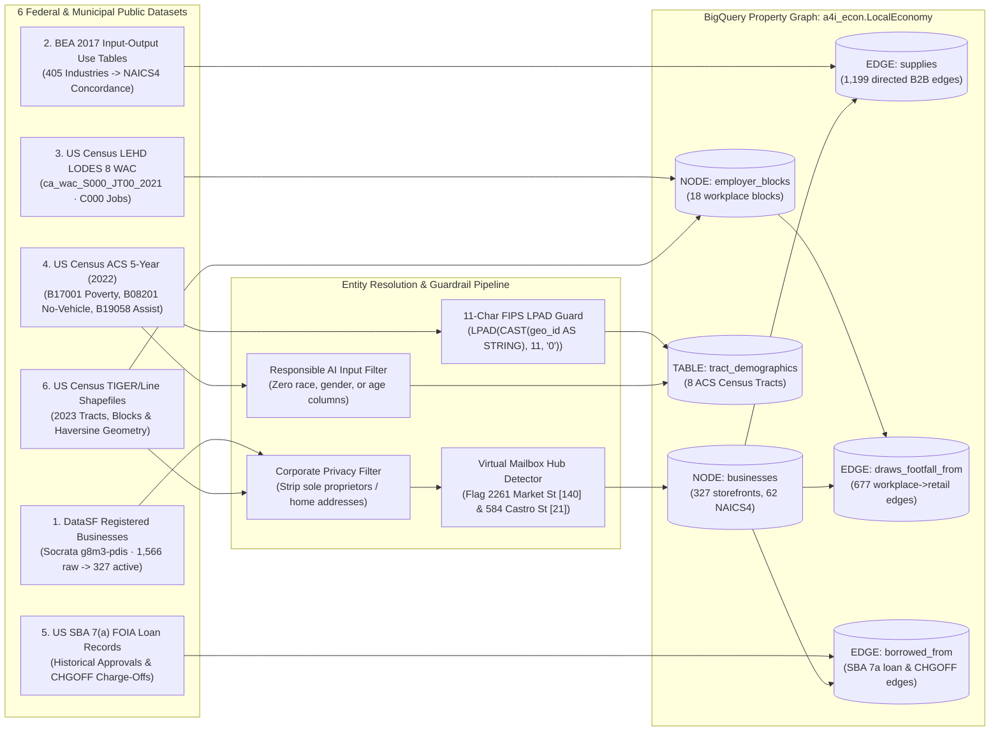
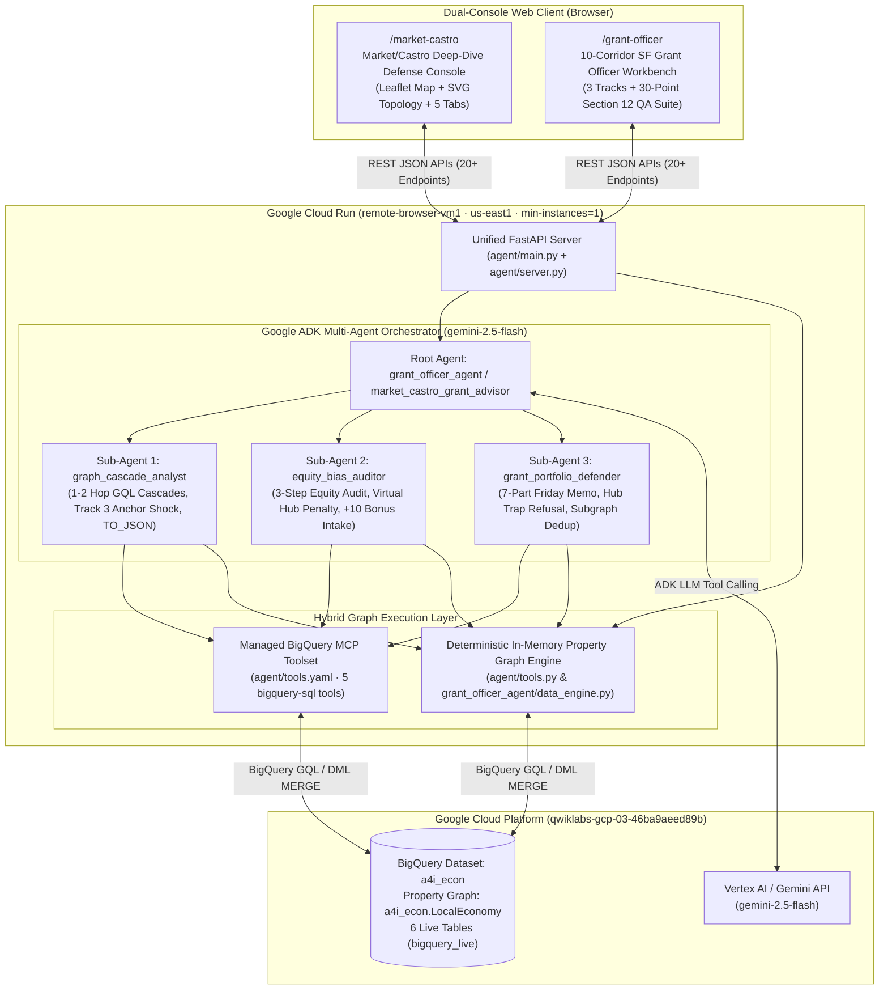

# Product Requirements Document (PRD) & Technical Architecture Specification
## Agents for Impact (A4I) 2026 — Challenge 03: Community Economic Resilience & Micro-Grants

> [!IMPORTANT]
> **Live Production Deployment (Verified `19/19 PASS`):**
> - **Cloud Run Base URL:** [`https://remote-browser-vm1-187574395280.us-east1.run.app`](https://remote-browser-vm1-187574395280.us-east1.run.app)
> - **10-Corridor SF Grant Officer Workbench:** [`/grant-officer`](https://remote-browser-vm1-187574395280.us-east1.run.app/grant-officer)
> - **Market/Castro Deep-Dive Defense Console:** [`/market-castro`](https://remote-browser-vm1-187574395280.us-east1.run.app/market-castro)
> - **GCP Project / Region:** `qwiklabs-gcp-03-46ba9aeed89b` (`us-east1`) · **BigQuery Property Graph:** `a4i_econ.LocalEconomy` (`bigquery_live`)

---

## 1. Executive Summary & Product Vision

### 1.1 Problem Statement
Municipal economic development officers allocate scarce micro-grant stabilization pools (typically `\$50,000` per neighborhood corridor, awarded in `\$15,000–\$25,000` tranches) under severe time and information constraints. Traditional allocation relies on either:
1. **First-come, first-served lottery spreadsheets** that ignore supply-chain contagion when a keystone local supplier closes, or
2. **Naive network degree centrality** that accidentally prioritizes **virtual mailbox agglomerations** (`140` shell LLCs registered at a single postal counter at `2261 Market St`), **single-industry BEA concordance monopolies**, or **redundant grantees** whose downstream 2-hop buyer subgraphs overlap by `90–100%`.

### 1.2 Product Solution
The **ATL8 Community Economic Resilience & Micro-Grant Defense Console** combines a **BigQuery Graph Query Language (GQL) Property Graph (`a4i_econ.LocalEconomy`)**, a **Google ADK Multi-Agent System (`root_agent` + 3 specialized sub-agents)**, a **Managed BigQuery MCP Toolset**, and a **Dual-Console Web UI** to transform raw federal and municipal datasets into an audit-ready **7-Part Friday Grant Committee Defense Memo** and a **Subgraph-Deduplicated Grant Portfolio**.

### 1.3 Official Judging Rubric Cross-Validation Matrix (`100/100 + 10 Bonus`)

| Judging Criterion | Weight | Official Requirement & Failure Traps Avoided | Verified Production Implementation | Owner |
| :--- | :---: | :--- | :--- | :---: |
| **1. Technical Implementation (BigQuery GQL, ADK, MCP)** | **30 pts** | Native `GRAPH a4i_econ.LocalEconomy` GQL (`MATCH`, `NEXT`, `FILTER WHERE`, `ANY SHORTEST`, `TO_JSON(p)`), Google ADK multi-agent orchestration, Managed BigQuery MCP (`tools.yaml`), and all 7 GQL syntax traps avoided. | [`sql/01_create_property_graph.sql`](file:///Users/subbavanipenta/Desktop/GCP%20Agents/sql/01_create_property_graph.sql), [`sql/02_gql_cascade_queries.sql`](file:///Users/subbavanipenta/Desktop/GCP%20Agents/sql/02_gql_cascade_queries.sql), [`agent/agent.py`](file:///Users/subbavanipenta/Desktop/GCP%20Agents/agent/agent.py), [`agent/grant_officer_agent/agent.py`](file:///Users/subbavanipenta/Desktop/GCP%20Agents/agent/grant_officer_agent/agent.py), [`agent/tools.yaml`](file:///Users/subbavanipenta/Desktop/GCP%20Agents/agent/tools.yaml). | **Member 1 & Member 2** |
| **2. Data Hygiene, Entity Resolution & Bias Auditing** | **25 pts** | Filter non-corporate/home filings, penalize virtual mailbox hubs (`2261 Market St`, `584 Castro St`), audit BEA trade-table mechanical bias (`78%` food/mfg vs. `0%` personal services), enforce `LPAD(geo_id, 11, '0')` on CA FIPS `06075...`, and exclude race/gender/age from inputs. | [`sql/03_equity_and_bias_audit.sql`](file:///Users/subbavanipenta/Desktop/GCP%20Agents/sql/03_equity_and_bias_audit.sql), [`audit_corridor_equity_and_bias`](file:///Users/subbavanipenta/Desktop/GCP%20Agents/agent/tools.py), [`run_validation_suite`](file:///Users/subbavanipenta/Desktop/GCP%20Agents/agent/grant_officer_agent/data_engine.py) (`30/30` Section 12 QA checks). | **Member 1 & Member 2** |
| **3. Economic Reasoning & Portfolio Defense** | **25 pts** | *"Do not use the graph to produce a ranked list and then fund the top of it."* Model survival probability shift ($\Delta P$), substitutability discount, hub-trap rejection (`Theatre Rhinoceros` vs. `Cafe Du Nord`), and greedy 2-hop subgraph deduplication (`Theatre Rhinoceros` + `Canela`). | [`generate_friday_grant_memo`](file:///Users/subbavanipenta/Desktop/GCP%20Agents/agent/tools.py), [`optimize_corridor_portfolio`](file:///Users/subbavanipenta/Desktop/GCP%20Agents/agent/tools.py), [`compare_grant_candidates`](file:///Users/subbavanipenta/Desktop/GCP%20Agents/agent/tools.py). | **Member 2** |
| **4. Grant Officer UX, Visual Storytelling & Geospatial Clarity** | **20 pts** | Dual-console UX (`/market-castro` deep-dive + `/grant-officer` 10-corridor workbench), Leaflet.js geographic cascade map, interactive SVG `TO_JSON(p)` path inspector, Track 3 bi-directional anchor closure shock, and 3-sub-agent execution trace. | [`agent/static/index.html`](file:///Users/subbavanipenta/Desktop/GCP%20Agents/agent/static/index.html), [`agent/static/grant_officer.html`](file:///Users/subbavanipenta/Desktop/GCP%20Agents/agent/static/grant_officer.html), [`agent/main.py`](file:///Users/subbavanipenta/Desktop/GCP%20Agents/agent/main.py). | **Member 3** |
| **5. "What's Next" Bonus Deliverable** | **+10 pts** | Close the loop between **Modeled BEA Edges** and **Merchant-Verified Ground Truth** during grant intake, recomputing cascading jobs saved live and emitting BigQuery `MERGE` DML. | [`add_verified_merchant_supplier`](file:///Users/subbavanipenta/Desktop/GCP%20Agents/agent/tools.py) (`POST /api/merchant-intake` & `POST /api/intake`). | **Member 2 & Member 3** |

---

## 2. Data Layer Architecture (Member 1)

### 2.1 Six Integrated Public Datasets & Hygiene Pipeline
The data layer ([`scripts/build_local_corridor.py`](file:///Users/subbavanipenta/Desktop/GCP%20Agents/scripts/build_local_corridor.py) and [`agent/grant_officer_agent/data_engine.py`](file:///Users/subbavanipenta/Desktop/GCP%20Agents/agent/grant_officer_agent/data_engine.py)) ingests, cleans, and links six authoritative public data sources into the `a4i_econ` BigQuery dataset and local deterministic snapshot ([`data/market_castro_graph.json`](file:///Users/subbavanipenta/Desktop/GCP%20Agents/data/market_castro_graph.json)):



### 2.2 Dataset Specifications & Engineering Constants

| Dataset / Table | Source & Grain | Key Engineering Rules & Constants | `Market/Castro` Volume | Real vs. Modeled Evidence Status |
| :--- | :--- | :--- | :--- | :--- |
| **`a4i_econ.businesses`** | DataSF `g8m3-pdis` (`ttxid` business location ID) | Active tax filings only (`dba_end_date IS NULL`, valid `naics_code`, corporate entity filter). Co-tenant density `>= 15` flagged as `is_virtual_mailbox = TRUE` (`2261 Market St` = `140` entities; `584 Castro St` = `21` entities). | `327` active businesses (`62` distinct `NAICS4` sectors from `1,566` raw filings) | **REAL** (Verified municipal tax registry & coordinates) |
| **`a4i_econ.supplies`** | BEA 2017 Direct Requirements × Haversine Distance | `MAX_SUPPLY_METRES = 1,200m`, `SUPPLY_COEFF_FLOOR = 0.005`, `GENERIC_SUPPLIER_PCTL = 0.90`. Edge weight: $\text{intensity} = c_{\text{BEA}}(\text{NAICS}_u, \text{NAICS}_v) \cdot \exp(-d_{uv}/500)$. Upgraded to `user_verified = TRUE` via Merchant Intake. | `1,199` directed B2B edges | **MODELED** (Inferred from BEA IO concordance + proximity) until **REAL** via Merchant Intake |
| **`a4i_econ.employer_blocks`** | Census LEHD LODES 8 WAC (`w_geocode` 15-char block) | Top workplace employment blocks (`C000` total jobs, `CNS07` retail, `CNS18` food/accommodation, `CNS15` health/social). Top anchor: Block `060750207003000` (`785` jobs). | `18` workplace blocks | **REAL** (Federal unemployment insurance payroll counts) |
| **`a4i_econ.draws_footfall_from`** | LODES Block Jobs × Storefront Haversine Distance | `FOOTFALL_METRES = 500m` pedestrian lunch/errand radius. Gravity allocation: $w_{bf} = \text{jobs}_b \cdot \exp(-d_{bf}/250)$. | `677` directed footfall edges | **MODELED** (Distance-decay allocation of real block jobs) |
| **`a4i_econ.borrowed_from`** | SBA 7(a) FOIA Loan Data | Matches historical SBA 7(a) approvals & `CHGOFF` charge-offs (`Castro Tarts Cafe And Bakery` `\$50k`, `Jake's Castro Kitchen` `\$85k`) to corridor storefronts and peer `NAICS4` industries. | `9` corridor loan records (`\$1,370,500` total, `2` `CHGOFF` defaults) | **REAL** (Federal SBA FOIA loan performance ground truth) |
| **`a4i_econ.tract_demographics`** | Census ACS 5-Year (`B17001`, `B08201`, `B19058`, `B19013`) | Joined via `LPAD(CAST(geo_id AS STRING), 11, '0')` to prevent California `06` leading-zero loss. Composite `economic_need_index` built strictly from poverty, no-vehicle, and public assistance rates (**zero race/ethnicity/gender columns**). | `8` Census Tracts in `Market/Castro` (`10` corridors citywide) | **REAL** (Federal ACS socioeconomic survey estimates) |

### 2.3 BigQuery Property Graph DDL & 7 GQL Syntax Guardrails
Defined in [`sql/01_create_property_graph.sql`](file:///Users/subbavanipenta/Desktop/GCP%20Agents/sql/01_create_property_graph.sql) and [`sql/02_gql_cascade_queries.sql`](file:///Users/subbavanipenta/Desktop/GCP%20Agents/sql/02_gql_cascade_queries.sql):

```sql
CREATE OR REPLACE PROPERTY GRAPH a4i_econ.LocalEconomy
  NODE TABLES (
    a4i_econ.businesses
      KEY (business_id)
      LABEL Business
      PROPERTIES (
        business_id, name, address, corridor, naics4, naics_title,
        latitude, longitude, tract_geoid, est_employees,
        is_virtual_mailbox, address_cotenant_count, fragility_score
      ),
    a4i_econ.employer_blocks
      KEY (block_id)
      LABEL EmployerBlock
      PROPERTIES (block_id, corridor, total_jobs, tract_geoid, latitude, longitude)
  )
  EDGE TABLES (
    a4i_econ.supplies
      KEY (edge_id)
      SOURCE KEY (supplier_id) REFERENCES businesses (business_id)
      DESTINATION KEY (buyer_id) REFERENCES businesses (business_id)
      LABEL Supplies
      PROPERTIES (edge_id, supplier_id, buyer_id, intensity, metres, user_verified),
    a4i_econ.draws_footfall_from
      KEY (edge_id)
      SOURCE KEY (block_id) REFERENCES employer_blocks (block_id)
      DESTINATION KEY (business_id) REFERENCES businesses (business_id)
      LABEL DrawsFootfall
      PROPERTIES (edge_id, block_id, business_id, worker_share, metres)
  );
```

> [!WARNING]
> **7 BigQuery GQL Syntax Traps Enforced Across All Queries ([`sql/02_gql_cascade_queries.sql`](file:///Users/subbavanipenta/Desktop/GCP%20Agents/sql/02_gql_cascade_queries.sql)):**
> 1. **Unbackticked Table Identifiers in DDL:** `NODE TABLES (a4i_econ.businesses ...)` — backticking table names inside `CREATE PROPERTY GRAPH` raises a parser error.
> 2. **Unqualified `REFERENCES` Alias:** `REFERENCES businesses (business_id)` — qualifying `REFERENCES a4i_econ.businesses` fails DDL compilation.
> 3. **No SQL `HAVING` in GQL:** Post-aggregation filtering uses `RETURN ... GROUP BY ... NEXT FILTER WHERE exposed_2hop BETWEEN 5 AND 25`.
> 4. **Bounded Shortest-Path Quantifiers:** Multi-hop cascades use `MATCH p = ANY SHORTEST (seed:Business)-[:Supplies]->{1,2}(downstream:Business)` to prevent combinatorial path explosion.
> 5. **Native Path Serialization:** Uses `TO_JSON(p) AS path_json` to export complete node-and-edge path structures directly to the UI topology visualizer.
> 6. **Bi-Directional Pattern Chaining (Track 3):** Chains forward footfall edges and backward supply edges in a single pattern: `MATCH (anchor:EmployerBlock)-[f:DrawsFootfall]->(shop:Business)<-[s:Supplies]-{1,2}(upstream:Business)`.
> 7. **11-Character FIPS Join Key:** Always wraps `tract_geoid` with `LPAD(CAST(geo_id AS STRING), 11, '0')` before joining ACS demographics.

---

## 3. Full System & Multi-Agent Architecture (Member 2)

### 3.1 High-Level Cloud Run & Hybrid Graph Execution Architecture



### 3.2 Google ADK Multi-Agent Hierarchy & 3-Sub-Agent Sequential Pipeline
Implemented in [`agent/agent.py`](file:///Users/subbavanipenta/Desktop/GCP%20Agents/agent/agent.py) and [`agent/grant_officer_agent/agent.py`](file:///Users/subbavanipenta/Desktop/GCP%20Agents/agent/grant_officer_agent/agent.py), and traceable live via `GET /api/workflow`:

1. **`graph_cascade_analyst` (Sub-Agent 1 — Topology & Contagion Specialist):**
   - **Responsibility:** Traverses 1-to-2 hop `Supplies` cascades (`ANY SHORTEST`), extracts `TO_JSON(p)` path objects with `lat`/`lon` coordinates, filters candidates to the **Actionable Sweet-Spot Band (`5–25` 2-hop reach)**, and runs **Track 3 Bi-Directional Anchor Institution Closure** simulations (`DrawsFootfall` → `Supplies`).
   - **Tools:** [`discover_cascade_candidates`](file:///Users/subbavanipenta/Desktop/GCP%20Agents/agent/tools.py), [`traverse_supply_cascade`](file:///Users/subbavanipenta/Desktop/GCP%20Agents/agent/grant_officer_agent/agent.py), [`simulate_anchor_closure`](file:///Users/subbavanipenta/Desktop/GCP%20Agents/agent/tools.py), [`trace_anchor_closure_shock`](file:///Users/subbavanipenta/Desktop/GCP%20Agents/agent/grant_officer_agent/agent.py).
2. **`equity_bias_auditor` (Sub-Agent 2 — Responsible AI, Data Hygiene & Intake Specialist):**
   - **Responsibility:** Executes the **3-Step Equity & BEA Mechanical Bias Audit**:
     - *Step 1 (Neighborhood Socioeconomic Equity):* Joins 11-char ACS tracts (`poverty_rate`, `no_vehicle_rate`, `public_assistance_rate`) with zero demographic/race inputs.
     - *Step 2 (BEA Structural Bias & Leaf-Node Refusal):* Flags that BEA IO tables concentrate `78%` of supply edges in food/manufacturing (`NAICS 311/312/722`) while B2C personal services (`NAICS 8121` dry cleaners/barbers) have `0` outgoing B2B edges — recommending a `15%` direct-relief reserve rather than fabricating graph edges.
     - *Step 3 (Entity Hygiene & `+10 Bonus` Merchant Intake):* Penalizes virtual mailbox hubs (`2261 Market St` & `584 Castro St` by `0.55x`), flags single-industry monopolies (`Primo`), and processes owner-verified supplier invoices via `POST /api/merchant-intake` (`MERGE INTO a4i_econ.supplies`).
   - **Tools:** [`audit_corridor_equity_and_bias`](file:///Users/subbavanipenta/Desktop/GCP%20Agents/agent/tools.py), [`run_equity_and_bias_audit`](file:///Users/subbavanipenta/Desktop/GCP%20Agents/agent/grant_officer_agent/agent.py), [`add_verified_merchant_supplier`](file:///Users/subbavanipenta/Desktop/GCP%20Agents/agent/tools.py), [`validate_graph_and_qa_checks`](file:///Users/subbavanipenta/Desktop/GCP%20Agents/agent/grant_officer_agent/agent.py).
3. **`grant_portfolio_defender` (Sub-Agent 3 — Economic Decision & Portfolio Optimizer):**
   - **Responsibility:** Synthesizes Sub-Agent 1 and Sub-Agent 2 outputs into the **7-Part Friday Committee Defense Memo**, defends why **Sweet-Spot Keystone `#1 Theatre Rhinoceros` (`1029446-11-151`)** beats **Centrality Hub Trap `Cafe Du Nord` (`1265022-03-201`)**, and runs greedy subgraph-deduplicated portfolio optimization across a `\$50,000` budget pool.
   - **Tools:** [`generate_friday_grant_memo`](file:///Users/subbavanipenta/Desktop/GCP%20Agents/agent/tools.py), [`optimize_corridor_portfolio`](file:///Users/subbavanipenta/Desktop/GCP%20Agents/agent/tools.py), [`compare_grant_candidates`](file:///Users/subbavanipenta/Desktop/GCP%20Agents/agent/tools.py), [`rank_corridor_grant_candidates`](file:///Users/subbavanipenta/Desktop/GCP%20Agents/agent/grant_officer_agent/agent.py).

### 3.3 Mathematical Model & Economic Formulas ([`agent/tools.py`](file:///Users/subbavanipenta/Desktop/GCP%20Agents/agent/tools.py))

1. **2-Hop Cascade Exposure & Weakest-Link Path Attenuation:**
   For a seed supplier $s$, each 1-hop path $p_1 = (s \to u)$ carries weight $w(p_1) = \text{intensity}(s, u)$, and each 2-hop shortest path $p_2 = (s \to u \to v)$ carries multiplicative attenuation $w_{\text{mult}}(p_2) = \text{intensity}(s, u) \cdot \text{intensity}(u, v)$ and weakest-link capacity $w_{\min}(p_2) = \min\big(\text{intensity}(s, u), \text{intensity}(u, v)\big)$.
2. **Expected Cascading Jobs Saved ($\Delta P$ Intervention Model):**
   $$\text{JobsSaved}(s) = \Delta P_{\text{grant}} \times (1 - \sigma_{\text{sub}}) \times \left(\text{Jobs}_{\text{direct}}(s) + \sum_{u \in \text{Hop}_1(s)} w(s,u)\,\text{Jobs}(u) + \gamma \sum_{v \in \text{Hop}_2(s)} w_{\text{mult}}(s,u,v)\,\text{Jobs}(v)\right)$$
   where $\Delta P_{\text{grant}} = P(\text{fail} \mid \text{no grant}) - P(\text{fail} \mid \text{grant})$ (default `0.65 - 0.15 = 0.50`) and $\sigma_{\text{sub}}$ is the supplier substitutability discount (default `0.20`).
   - **Production Benchmark (`Market/Castro`, `\$25,000` Grant):**
     - **Primary Recommendation (`Theatre Rhinoceros`, `1029446-11-151`):** `14.69` cascading jobs saved (`\$1,701.84` cost per job protected).
     - **Centrality Hub Trap (`Cafe Du Nord`, `1265022-03-201`, `38` Hop-1 edges):** `9.55` cascading jobs saved (`\$2,618.23` cost per job protected, plus active SBA 7(a) `PIF` robust balance sheet reduces marginal $\Delta P$).
3. **Subgraph-Deduplicated Portfolio Optimization (`optimize_corridor_portfolio`):**
   Given budget pool $B = \$50,000$ and minimum effective grant floor $G_{\min} = \$15,000$, each candidate $s_k$ is selected greedily to maximize **marginal uncovered physical 2-hop reach**:
   $$\text{MarginalGain}(s_k \mid \mathcal{C}_{k-1}) = \text{KeystoneScore}(s_k) \times \frac{|\text{PhysReach}_{1..2}(s_k) \setminus \mathcal{C}_{k-1}|}{|\text{PhysReach}_{1..2}(s_k)|}$$
   - **Production Result:** Selects **`Theatre Rhinoceros` (`\$25,000`) + `Canela` (`\$25,000`)**, protecting **`21` unique 2-hop nodes (`13` physical brick-and-mortar businesses, `27.80` deduplicated jobs saved)** while rejecting `#3 The Castro` (`91.7%` subgraph overlap) and `#4 Hi Tops` (`100%` overlap).

### 3.4 Complete Unified REST API Reference ([`agent/main.py`](file:///Users/subbavanipenta/Desktop/GCP%20Agents/agent/main.py) & [`agent/server.py`](file:///Users/subbavanipenta/Desktop/GCP%20Agents/agent/server.py))

| Category | Endpoint | Method | Description & Key Response Fields |
| :--- | :--- | :---: | :--- |
| **Health & Graph Ops** | `/api/health` | `GET` | Live BigQuery status (`connected: true`, `mode: "bigquery_live"`), node/edge counts (`327` businesses, `1,199` supplies, `677` footfall), SQL file checks. |
| **Health & Graph Ops** | `/api/init-graph` | `POST` | Executes live `CREATE OR REPLACE PROPERTY GRAPH a4i_econ.LocalEconomy` DDL in BigQuery (`status: "created"`). |
| **Health & Graph Ops** | `/api/reload` | `POST` | Zero-downtime hot reload of [`data/market_castro_graph.json`](file:///Users/subbavanipenta/Desktop/GCP%20Agents/data/market_castro_graph.json) (`327` nodes, `1,199` edges). |
| **ADK & MCP Metadata** | `/api/agent-info` | `GET` | Google ADK root agent metadata, `3` sub-agents, `15` registered tools, and `10` SF corridors. |
| **ADK & MCP Metadata** | `/api/hierarchy` | `GET` | Detailed ADK agent hierarchy (`market_castro_grant_advisor` → 3 sub-agents) and tool bindings. |
| **ADK & MCP Metadata** | `/api/mcp-status` | `GET` | Managed BigQuery MCP configuration (`agent/tools.yaml`) with `5` parameterized GQL/SQL tools. |
| **ADK & MCP Metadata** | `/api/workflow` | `GET` | Live 3-sub-agent sequential pipeline execution trace (`graph_cascade_analyst` → `equity_bias_auditor` → `grant_portfolio_defender`). |
| **Market/Castro APIs** | `/api/overview` | `GET` | Initial state bundle for `/market-castro`: corridor summary, sweet-spot candidates, default 7-part memo, deduplicated portfolio, and audit highlights. |
| **Market/Castro APIs** | `/api/memo` | `GET` | Parameterized 7-Part Friday Committee Defense Memo + `to_json_paths` + `cascade_nodes` (with `lat`/`lon`) + ACS tract context. |
| **Market/Castro APIs** | `/api/portfolio` | `GET` | Subgraph-deduplicated portfolio optimizer (`Theatre Rhinoceros` + `Canela`) + naive top-4 overlap audit. |
| **Market/Castro APIs** | `/api/anchor-shock` | `GET` | Track 3 bi-directional anchor closure shock (`Block 060750207003000`, `785` jobs → `106` storefronts → `36` upstream suppliers). |
| **Market/Castro APIs** | `/api/equity-audit` | `GET` | 3-Step Equity & BEA Mechanical Bias Audit (`8` 11-char ACS tracts, virtual mailbox traps, SBA 7(a) charge-offs). |
| **Market/Castro APIs** | `/api/merchant-intake` | `POST` | `+10 Bonus` live merchant supplier verification (`user_verified=TRUE`, emits BigQuery `MERGE` DML, recomputes jobs saved `14.69` → `40.98`). |
| **10-Corridor SF APIs** | `/api/corridors` | `GET` | Registry and metadata for all `10` San Francisco commercial corridors. |
| **10-Corridor SF APIs** | `/api/analyze` | `GET` | Multi-corridor grant portfolio, 2-hop cascade, and Friday Memo for any of the `10` SF corridors (`?corridor=Central+Market`). |
| **10-Corridor SF APIs** | `/api/qa-validate` | `GET` | Executes the **30-Point Section 12 Data, GQL & Responsible AI Guardrail Validation Suite** (`30/30 PASS`). |
| **Conversational AI** | `/api/chat` | `POST` | Grounded multi-agent chat backed by Gemini 2.5 Flash + deterministic GQL tool execution. |
| **PRD Downloads** | `/prd` & `/api/download/prd.md` | `GET` | Printable HTML/PDF viewer and direct `.md` file download of this PRD & Technical Specification. |

---

## 4. User Interface Architecture & Dual-Console Specification (Member 3)

### 4.1 Dual-Console Architecture & Navigation Switcher
The frontend layer serves two purpose-built, interconnected consoles connected by a persistent top navigation switcher:
1. **Console A — Market/Castro Deep-Dive Defense Console ([`/market-castro`](https://remote-browser-vm1-187574395280.us-east1.run.app/market-castro), [`agent/static/index.html`](file:///Users/subbavanipenta/Desktop/GCP%20Agents/agent/static/index.html)):**
   - Designed for the **Market/Castro Grant Committee Deep-Dive** (`327` storefronts, `1,199` BEA `Supplies` edges, `677` LODES `DrawsFootfall` edges).
2. **Console B — 10-Corridor SF Grant Officer Workbench ([`/grant-officer`](https://remote-browser-vm1-187574395280.us-east1.run.app/grant-officer), [`agent/static/grant_officer.html`](file:///Users/subbavanipenta/Desktop/GCP%20Agents/agent/static/grant_officer.html)):**
   - Designed for **Citywide Multi-Corridor Scaling** across `10` San Francisco commercial corridors (`Central Market`, `Mission / Calle 24`, `Chinatown`, `Bayview / Third Street`, `Excelsior`, `Castro / Upper Market`, `Haight-Ashbury`, `Inner Sunset`, `North Beach`, `Japantown / Fillmore`) and the **30-Point Section 12 QA Validation Suite**.

### 4.2 Interactive Wireframes & Tab Specifications

````carousel
```text
+----------------------------------------------------------------------------------------------------------+
| [A4I 2026 · Challenge 03] Market / Castro Economic Resilience Console   [Switch to 10-Corridor UI ->]   |
|----------------------------------------------------------------------------------------------------------|
| [Storefronts: 327] [BEA Supplies: 1,199] [LODES Footfall: 677] [Tracts: 8] [Jobs Saved: 14.69] [$1,702/J]|
+----------------------------------------------------------------------------------------------------------+
| Primary: [Theatre Rhinoceros v] | Runner-Up: [Cafe Du Nord v] | Grant: [===o===] $25k | Pool: $50,000    |
| P(fail|No Grant): [====o==] 65% | P(fail|Grant): [=o=====] 15%| Substitutability Discount: [==o====] 20% |
+----------------------------------------------------------------------------------------------------------+
| [Tab 1: 7-Part Memo & Map] [Tab 2: Equity & Bias] [Tab 3: Anchor Shock] [Tab 4: +10 Intake] [Tab 5: ADK] |
+---------------------------------------------------+------------------------------------------------------+
| FRIDAY GRANT COMMITTEE DEFENSE MEMO (7 SECTIONS)  | DUAL VISUALIZER: [Leaflet Geo Map] [SVG TO_JSON(p)]  |
| +-----------------------------------------------+ | +--------------------------------------------------+ |
| | 1. RECOMMENDATION & GRANT SPLIT               | | |   [OpenStreetMap / CARTO Dark Matter Tiles]      | |
| |    Theatre Rhinoceros (1029446-11-151) · $25k | | |      (Canela 37.765,-122.432)                    | |
| | 2. 1-TO-2 HOP CASCADE PROTECTION              | | |              \                                   | |
| |    7 Hop-1 + 11 Hop-2 -> 14.69 Jobs Protected | | |   * [THEATRE RHINOCEROS 37.7596,-122.4342]       | |
| | 3. GQL TRAVERSAL (ANY SHORTEST + TO_JSON(p))  | | |              /               \                   | |
| | 4. WHY NOT HUB TRAP (CAFE DU NORD · 38 EDGES) | | |   (The Castro)         (2261 Market Virtual Hub) | |
| | 5. EXPLICIT ΔP SURVIVAL & SUBSTITUTABILITY    | | +--------------------------------------------------+ |
| | 6. REAL VS. MODELED EVIDENCE AUDIT            | | SUBGRAPH-DEDUPLICATED PORTFOLIO ($50,000 POOL)       |
| | 7. ACS TRACT 06075020700 EQUITY CONTEXT       | | #1 Theatre Rhinoceros ($25k) + #2 Canela ($25k)      |
| +-----------------------------------------------+ | -> 21 Unique 2-Hop Nodes | 13 Physical | 27.80 Jobs  |
+---------------------------------------------------+------------------------------------------------------+
```
<!-- slide -->
```text
+----------------------------------------------------------------------------------------------------------+
| TAB 2: 3-STEP EQUITY, BEA MECHANICAL BIAS & VIRTUAL MAILBOX HYGIENE AUDIT (/api/equity-audit)            |
+---------------------------------------------------+------------------------------------------------------+
| STEP 1: ACS 11-CHAR TRACT EQUITY (0 RACE INPUTS)  | STEP 2: BEA MECHANICAL INDUSTRY BIAS AUDIT           |
| +-----------------------------------------------+ | +--------------------------------------------------+ |
| | Tract GEOID | Biz | Poverty | Car-Free | Need | | | * Food / Beverage / Mfg (NAICS 311/312/722): 78% | |
| | 06075016600 | 41  | 16.1%   | 52.3%    | High | | | * Personal Services (Dry Cleaners/Barbers):   0% | |
| | 06075020700 | 89  | 13.4%   | 46.8%    | Med  | | | -> Policy Guardrail: Carve out 15% non-graph     | |
| | 06075020800 | 54  | 11.8%   | 44.1%    | Med  | | |    Direct-Relief Reserve for leaf storefronts.   | |
| +-----------------------------------------------+ | +--------------------------------------------------+ |
| STEP 3: VIRTUAL MAILBOX & MONOPOLY PENALTIES      | REAL SBA 7(a) FOIA LOAN & CHARGE-OFF GROUND TRUTH    |
| +-----------------------------------------------+ | +--------------------------------------------------+ |
| | * 2261 Market St (140 co-tenants) -> 0.55x    | | | * Castro Tarts Cafe (564 Castro) · $50k · CHGOFF | |
| | * 584 Castro St  (21 co-tenants)  -> 0.55x    | | | * Jake's Castro Kitchen (2348 Mkt)· $85k · CHGOFF| |
| | * Primo (Sole NAICS 3121) -> Monopoly Penalty | | | * Duplicate DBAs merged (The Castro, Mudpuppy's) | |
| +-----------------------------------------------+ | +--------------------------------------------------+ |
+---------------------------------------------------+------------------------------------------------------+
```
<!-- slide -->
```text
+----------------------------------------------------------------------------------------------------------+
| TAB 3: TRACK 3 BI-DIRECTIONAL ANCHOR SHOCK  |  TAB 4: +10 BONUS INTAKE  |  TAB 5: 3-SUB-AGENT WORKFLOW   |
+---------------------------------------------+---------------------------+--------------------------------+
| TRACK 3: ANCHOR CLOSURE (/api/anchor-shock) | +10 BONUS MERCHANT INTAKE | LIVE ADK PIPELINE (/api/workflow)|
| Block: [060750207003000 (785 Jobs)       v] | Supplier: [Theatre Rhino] | [Run Live 3-Agent Pipeline]    |
| GQL: (anchor)-[DrawsFootfall]->(shop)       | Buyer:    [Canela       ] | 1. graph_cascade_analyst       |
|      <-[Supplies]-{1,2}(upstream)           | Share:    [0.35         ] |    -> 15 candidates, 18paths   |
| * 106 Direct Footfall Storefronts Hit       | [Verify & Merge Edge]     | 2. equity_bias_auditor         |
| * 36 Upstream B2B Suppliers Hurt Indirectly | -> Jobs: 14.69 -> 40.98   |    -> 8 tracts, 2 virtual hubs |
|   (Even though they never sold to workers!) | -> Emits BQ MERGE DML     | 3. grant_portfolio_defender    |
|                                             |                           |    -> Memo + Portfolio (254ms) |
+---------------------------------------------+---------------------------+--------------------------------+
```
<!-- slide -->
```text
+----------------------------------------------------------------------------------------------------------+
| CONSOLE B: 10-CORRIDOR SF GRANT OFFICER WORKBENCH (/grant-officer)                                       |
+----------------------------------------------------------------------------------------------------------+
| Corridor: [Central Market v] (10 Corridors) | Track: [1. Main Street Storefront v] | Budget: [$50,000 v] |
| Split Mode: [Complementary 2-Grant Split ($30k Primary + $20k Runner-Up) v]       [Run Live BQ Graph DDL]|
+---------------------------------------------------+------------------------------------------------------+
| PRIMARY SWEET-SPOT RECOMMENDATION                 | 30-POINT SECTION 12 GRAPH & QA GUARDRAIL SUITE       |
| * Merchant Roots & Commissary LLC (Score: 76.2)   | [30 / 30 Checks Passed (100%)]                       |
| * Why Not Centrality Hub Trap?                    | - 1. Business Nodes (7/7 PASS: >=60, unique keys)    |
|   Rejects 38-edge hub Bay Area Restaurant Supply  | - 2. Supplies Edges (8/8 PASS: <=1200m, coeff>=0.005)|
|   (SBA PIF balance sheet, low marginal ΔP).       | - 3. Footfall Edges (4/4 PASS: <=500m, jobs > 0)     |
| * Interactive 2-Hop Cascade Graph & GQL Inspector | - 4. Tracts & Responsible AI (4/4 PASS: 11-char FIPS)|
| * Business Owner Supplier Intake Form (+10 Bonus) | - 5. SBA 7(a) FOIA Ground Truth (1/1 PASS: CHGOFF)   |
| * Grounded ADK Grant Committee Q&A Assistant      | - 6. GQL Syntax & Agent Guardrails (6/6 PASS)        |
+---------------------------------------------------+------------------------------------------------------+
```
````

---

## 5. Production Deployment & 19-Check Verification Suite

### 5.1 Cloud Run Production Environment
- **Service Name:** `remote-browser-vm1`
- **Public URL:** [`https://remote-browser-vm1-187574395280.us-east1.run.app`](https://remote-browser-vm1-187574395280.us-east1.run.app)
- **Container & Deployment Scripts:** [`agent/Dockerfile`](file:///Users/subbavanipenta/Desktop/GCP%20Agents/agent/Dockerfile), [`agent/deploy.sh`](file:///Users/subbavanipenta/Desktop/GCP%20Agents/agent/deploy.sh)
- **Automated Verification Suite:** [`scripts/test_production_integration.sh`](file:///Users/subbavanipenta/Desktop/GCP%20Agents/scripts/test_production_integration.sh)

### 5.2 Live Production Verification Results (`19/19 PASS`)

| Check ID | Verification Check | Live Production Result (`remote-browser-vm1`) | Status |
| :---: | :--- | :--- | :---: |
| **`M1.1`** | Health & Graph Snapshot Contract (`/api/health`) | `businesses=327`, `supplies=1199`, `footfall=677` | **PASS** |
| **`M1.2`** | 11-Char `LPAD` Tract GEOIDs & SQL DDL/GQL Scripts | `tracts=8` (`06075...`), all 3 `.sql` files verified | **PASS** |
| **`M1.3`** | Live BigQuery Dataset & Property Graph Status | `connected=True`, `mode=bigquery_live`, `graph=a4i_econ.LocalEconomy` | **PASS** |
| **`M1.4`** | Zero-Downtime Member 1 Graph Hot-Reload (`POST /api/reload`) | Reloaded `327` businesses & `1,199` `Supplies` edges | **PASS** |
| **`M2.1`** | Google ADK Root Agent + 3 Sub-Agents (`/api/agent-info`) | `sub_agents=3`, `tools=15`, `corridors=10` | **PASS** |
| **`M2.2`** | Managed BigQuery MCP & Hierarchy (`/api/hierarchy`, `/api/mcp-status`) | `root=market_castro_grant_advisor`, `mcp_tools=5` | **PASS** |
| **`M2.3`** | 7-Part Friday Memo + Geo Cascade + `TO_JSON(p)` (`/api/memo`) | `jobs_saved=14.69`, `cost_per_job=$1,701.84`, `lat=37.759599` | **PASS** |
| **`M2.4`** | Subgraph-Deduplicated Portfolio (`/api/portfolio`) | `['Theatre Rhinoceros', 'Canela']`, `unique_2hop=21`, `physical=13` | **PASS** |
| **`M2.5`** | Track 3 Bi-Directional Anchor Shock (`/api/anchor-shock`) | `anchor_jobs=785`, `storefronts_hit=106`, `upstream_hurt=36` | **PASS** |
| **`M2.6`** | 3-Step Equity & BEA Mechanical Bias Audit (`/api/equity-audit`) | `tracts=8`, `bea_sectors=2`, `virtual_hubs=2` | **PASS** |
| **`M2.7`** | `+10 Bonus` Merchant Supplier Intake (`POST /api/merchant-intake`) | `verified_intensity=0.35`, `jobs_after=40.98`, BQ `MERGE` DML | **PASS** |
| **`M2.8`** | 3-Sub-Agent Sequential Pipeline Trace (`/api/workflow`) | All 3 sub-agents traced in `253.78 ms` | **PASS** |
| **`M2.9`** | Grounded Multi-Agent Chat (`POST /api/chat`) | `engine=adk-graph-tool-engine`, `tool=compare_grant_candidates` | **PASS** |
| **`M3.1`** | 10-Corridor Grant Officer UI (`GET /grant-officer`) | `HTTP 200` (`64,956` bytes), switcher to `/market-castro` verified | **PASS** |
| **`M3.2`** | Market/Castro Deep-Dive UI (`GET /market-castro`) | `HTTP 200` (`89,499` bytes), Leaflet map + Tab 5 + switcher verified | **PASS** |
| **`M4.1`** | 10-Corridor Registry & Metadata (`/api/corridors`) | `corridors_loaded=10` | **PASS** |
| **`M4.2`** | Multi-Corridor Grant Analysis (`/api/analyze?corridor=Central+Market`) | `Merchant Roots & Commissary LLC` (`central-market-b01`, score `76.2`) | **PASS** |
| **`M4.3`** | 30-Point Section 12 Graph & QA Guardrail Suite (`/api/qa-validate`) | `all_passed=True`, `passed=30/30` | **PASS** |
| **`M4.4`** | Live BigQuery Property Graph Provisioner (`POST /api/init-graph`) | `status=created`, `graph=qwiklabs-gcp-03-46ba9aeed89b.a4i_econ.LocalEconomy` | **PASS** |

---

## 6. Reproducibility & Multi-Corridor Extensibility

```bash
# 1. Rebuild or switch local corridor graph snapshot (Member 1)
CORRIDOR_NAME="Market/Castro" GRAPH_JSON_PATH="data/market_castro_graph.json" \
  python3 scripts/build_local_corridor.py

# 2. Run unified FastAPI + Google ADK server locally on port 8080 (Member 2 & 3)
PYTHONPATH=.:./agent uvicorn agent.main:app --host 0.0.0.0 --port 8080

# 3. Run the 19-check production integration validation suite against Cloud Run
bash scripts/test_production_integration.sh https://remote-browser-vm1-187574395280.us-east1.run.app
```
