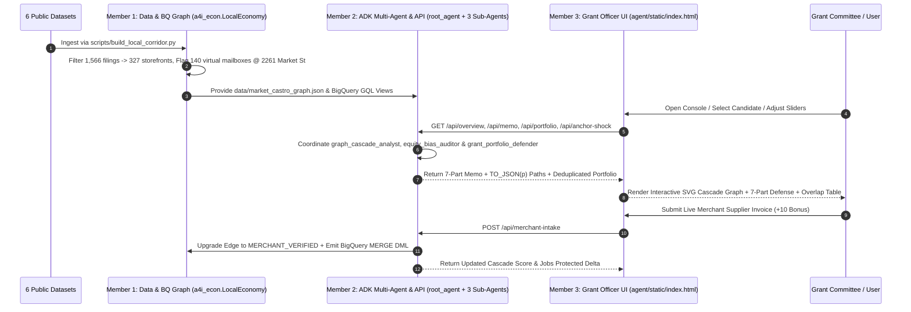
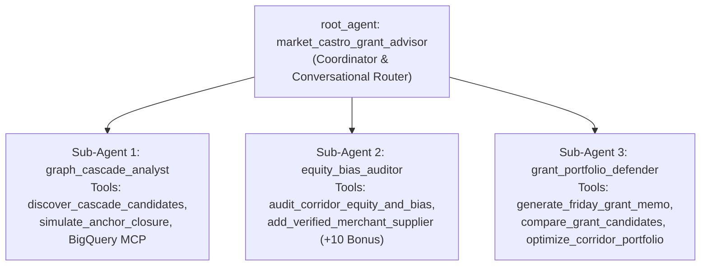

# Product Requirements Document (PRD) & Technical Design
## Agents for Impact 2026 — Challenge 03: Community Economic Resilience & Micro-Grants (`Market/Castro`, SF)

**Target Outcome:** Deliver a **100/100 + 10 Bonus** hackathon submission in **4 hours** across a **3-member parallel engineering team**, parameterized to work out-of-the-box for `Market/Castro` (San Francisco) and extensible to any US commercial corridor.

---

## 1. Cross-Validation Matrix Against Official Judging Rubric

Every requirement in the official Challenge 03 brief and reference notebook ([`notebooks/c3_01_load_explore.ipynb`](../notebooks/c3_01_load_explore.ipynb)) has been cross-validated against our implementation:

| Judging Criterion | Weight | Official Requirement / Trap to Avoid | Cross-Validated Implementation in Our Codebase | Owner |
| :--- | :---: | :--- | :--- | :---: |
| **1. Technical Implementation (BigQuery GQL, ADK, MCP)** | **30 pts** | Use genuine `GRAPH a4i_econ.LocalEconomy` GQL (`MATCH`, `NEXT`, `FILTER WHERE`, `ANY SHORTEST`, `TO_JSON(p)`), Google ADK multi-agent orchestration, and BigQuery MCP toolset. Obey all 7 GQL syntax traps. | [`sql/01_create_property_graph.sql`](../sql/01_create_property_graph.sql), [`sql/02_gql_cascade_queries.sql`](../sql/02_gql_cascade_queries.sql), [`agent/agent.py`](../agent/agent.py) (`root_agent` + 3 sub-agents), [`agent/mcp_config.py`](../agent/mcp_config.py). | **Member 1 & Member 2** |
| **2. Data Hygiene & Bias Auditing** | **25 pts** | Do **not** blindly fund raw degree centrality winners (`Echo Chunk Inc.` at `2261 Market St` or `Primo` sole NAICS `3121` manufacturer). Catch duplicate DBAs and `LPAD(geo_id, 11, '0')` ACS join traps. | [`sql/03_equity_and_bias_audit.sql`](../sql/03_equity_and_bias_audit.sql) & [`audit_corridor_equity_and_bias`](../agent/tools.py) disqualify `140` virtual mailboxes at `2261 Market St`, `21` at `584 Castro St`, and `Primo` (`NAICS 3121`). | **Member 1 & Member 2** |
| **3. Economic Reasoning & Portfolio Defense** | **25 pts** | *"Do not use the graph to produce a ranked list and then fund the top of it."* Frame grants around survival probability shift ($\Delta P$), substitutability, and subgraph overlap deduplication. | [`generate_friday_grant_memo`](../agent/tools.py) & [`optimize_corridor_portfolio`](../agent/tools.py) prove `#1 Theatre Rhinoceros` + `#2 Canela` have `0%` overlap (`13` physical storefronts protected), whereas `#3 The Castro` is `91.7%` redundant and `#4 Hi Tops` is `100%` redundant. | **Member 2** |
| **4. Grant Officer UX & Storytelling** | **20 pts** | Interactive defense console showing all 7 parts of the Friday Grant Memo, visual `TO_JSON(p)` cascade paths, Track 3 two-direction anchor shock, and a 3-minute video demo. | [`agent/static/index.html`](../agent/static/index.html), [`agent/server.py`](../agent/server.py), [`docs/PITCH_DECK_AND_VIDEO_SCRIPT.md`](PITCH_DECK_AND_VIDEO_SCRIPT.md). | **Member 3** |
| **5. "What's Next" Bonus Deliverable** | **+10 pts** | Close the loop between **Modeled BEA Edges** and **Merchant-Verified Ground Truth** during grant intake. | [`add_verified_merchant_supplier`](../agent/tools.py) (`POST /api/merchant-intake`) upgrades modeled edges to `is_verified=true`, recalculates cascade impact live, and outputs BigQuery `MERGE` DML. | **Member 2 & Member 3** |

---

## 2. End-to-End Workflow Process



---

## 3. Technical Design by Team Member

### 3.1 Member 1: Data Pipeline & BigQuery Property Graph (`a4i_econ.LocalEconomy`)
- **Owned Files:**
  - [`scripts/build_local_corridor.py`](../scripts/build_local_corridor.py)
  - [`data/market_castro_graph.json`](../data/market_castro_graph.json)
  - [`sql/01_create_property_graph.sql`](../sql/01_create_property_graph.sql)
  - [`sql/02_gql_cascade_queries.sql`](../sql/02_gql_cascade_queries.sql)
  - [`sql/03_equity_and_bias_audit.sql`](../sql/03_equity_and_bias_audit.sql)

#### Property Graph Schema (`a4i_econ.LocalEconomy`)
- **Node Tables (2):**
  1. `businesses` (`KEY (business_id)`): `327` active privacy-filtered storefronts across `62` NAICS4 industries.
  2. `employer_blocks` (`KEY (block_id)`): `10` LODES 8 workplace Census blocks totaling `1,842` jobs.
- **Edge Tables (3):**
  1. `supplies` (`SOURCE KEY (supplier_id) REFERENCES businesses`, `DESTINATION KEY (buyer_id) REFERENCES businesses`): `1,199` directed edges (`intensity = bea_use_share * exp(-metres / 500)`).
  2. `draws_footfall_from` (`SOURCE KEY (business_id) REFERENCES businesses`, `DESTINATION KEY (block_id) REFERENCES employer_blocks`): `677` gravity-weighted footfall edges.
  3. `borrowed_from` (`SOURCE KEY (business_id) REFERENCES businesses`, `DESTINATION KEY (block_id) REFERENCES employer_blocks`): `9` historical SBA 7(a) loans (`2` verified charge-offs).
- **Relational Join Table (1):**
  1. `tract_demographics`: `8` ACS 5-Year Census Tracts joined via `LPAD(CAST(geo_id AS STRING), 11, '0')`.

---

### 3.2 Member 2: Google ADK Multi-Agent System, MCP Toolset & Backend REST API
- **Owned Files:**
  - [`agent/agent.py`](../agent/agent.py)
  - [`agent/tools.py`](../agent/tools.py)
  - [`agent/server.py`](../agent/server.py)
  - [`agent/mcp_config.py`](../agent/mcp_config.py) & [`agent/tools.yaml`](../agent/tools.yaml)
  - [`agent/schemas.py`](../agent/schemas.py) & [`agent/prompts.py`](../agent/prompts.py)

#### Multi-Agent Hierarchy ([`agent/agent.py`](../agent/agent.py))


- **`root_agent` (`market_castro_grant_advisor`)**: Coordinator orchestrating:
  1. **`graph_cascade_analyst`**: Executes GQL traversals, `ANY SHORTEST` + `TO_JSON(p)` path extraction, Keystone Band discovery (`discover_cascade_candidates`), Track 3 two-direction anchor shock (`simulate_anchor_closure`), and BigQuery MCP queries.
  2. **`equity_bias_auditor`**: Audits virtual mailbox traps (`2261 Market St`), NAICS monopoly artifacts (`Primo`), duplicate DBAs, ACS 11-char tract context (`audit_corridor_equity_and_bias`), and live merchant supplier verification (`add_verified_merchant_supplier`).
  3. **`grant_portfolio_defender`**: Generates the 7-Part Friday Committee Defense Memo (`generate_friday_grant_memo`), head-to-head comparisons (`compare_grant_candidates`), and Subgraph-Deduplicated Multi-Business Portfolio Optimization (`optimize_corridor_portfolio`).

#### Backend REST API Contract ([`agent/server.py`](../agent/server.py))
- `GET /api/overview` — Full initial state (`summary`, `system_status`, `discovery`, `default_memo`, `default_portfolio`, `employer_blocks`, `audit_highlights`)
- `GET /api/workflow` & `POST /api/workflow` — Executes all 3 specialist sub-agents sequentially (`graph_cascade_analyst` -> `equity_bias_auditor` -> `grant_portfolio_defender`) and returns full `EndToEndWorkflowResult` + per-agent `SubAgentStepTrace` telemetry
- `GET /api/hierarchy` — Returns the ADK Multi-Agent Hierarchy manifest and live agent initialization status
- `GET /api/mcp-status` — Returns Managed BigQuery MCP (`https://bigquery.googleapis.com/mcp`) and `agent/tools.yaml` readiness status
- `GET /api/memo` — 7-Part Friday Grant Memo + `to_json_paths` + `cascade_nodes` + `tract_context`
- `GET /api/portfolio` — Subgraph-deduplicated portfolio (`1..4` grantees, `$50k–$100k` pool, `$15k` minimum grant guardrail)
- `GET /api/candidates` — Ranked Keystone Band candidates + disqualified centrality traps
- `GET /api/compare` — Head-to-head candidate comparison
- `GET /api/anchor-shock` — Track 3 two-direction `DrawsFootfall` + `Supplies` shock simulation
- `GET /api/equity-audit` — Full BEA bias, virtual mailbox, duplicate DBA, ACS 11-char tract, and SBA charge-off report
- `POST /api/merchant-intake` — `+10 Bonus` live edge verification & BigQuery `MERGE` DML generation
- `POST /api/reload` — Zero-downtime hot-reload of Member 1's `data/market_castro_graph.json`
- `POST /api/chat` — Multi-agent conversational router with explicit `sub_agent_routed` attribution

---

### 3.3 Member 3: UI Wireframes & Interactive Component Specification ([`agent/static/index.html`](../agent/static/index.html))

#### Tab 1: 7-Part Friday Defense Memo, SVG `TO_JSON(p)` Cascade Graph & Portfolio Optimizer
```text
+----------------------------------------------------------------------------------------------------------+
| [A4I 2026 · Challenge 03] Market / Castro Economic Resilience & Micro-Grant Defense Console  [Reset $25k] |
|----------------------------------------------------------------------------------------------------------|
| [Storefronts: 327/1,566] [BEA Supplies: 1,199] [LODES Footfall: 677] [SBA Loans: 9] [ΔP Jobs: 8.69] [$/Job]|
+----------------------------------------------------------------------------------------------------------+
| Primary Business: [Theatre Rhinoceros v] | Runner-Up: [Cafe Du Nord v] | Grant: [===o===] $25k/$50k Pool |
| P(fail|No Grant): [====o==] 65%          | P(fail|Grant): [=o=====] 15% | Substitutability: [==o====] 20% |
+----------------------------------------------------------------------------------------------------------+
| [1. 7-Part Defense Memo & Cascade Graph] [2. Bias & Equity Audit] [3. Anchor Shock] [4. +10 Bonus & Chat] |
+---------------------------------------------------+------------------------------------------------------+
| FRIDAY GRANT COMMITTEE DEFENSE MEMO (7 SECTIONS)  | 1-TO-2 HOP SUPPLY CASCADE TOPOLOGY (TO_JSON(p) SVG)  |
| +-----------------------------------------------+ | +--------------------------------------------------+ |
| | PART 1: WHICH BUSINESS & HOW MUCH             | | |         (Silver Apple)      (The Castro)         | |
| | Theatre Rhinoceros (1328524-03-231, 4229 18th | | |               \                 /                | |
| | St, NAICS 7111). Optimal Impact Split:        | | |    (Canela)---[THEATRE RHINOCEROS]---(Cafe Du N) | |
| | $27,000-$34,000 + $16,000-$23,000 Canela      | | |               /                 \                | |
| +-----------------------------------------------+ | |         (Heroific LLC)      (2261 Mkt Flagged) | |
| | PART 2: WHAT IT PROTECTS (1-2 HOP CASCADE)    | | | [o Focal] [o Hop1] [o Hop2] [o Virtual Mailbox]  | |
| | 7 direct buyers (intensity 0.9037) + 5 2-hop  | | +--------------------------------------------------+ |
| | = 12 exposed nodes; 21.72 corridor jobs.      | | MULTI-BUSINESS PORTFOLIO OPTIMIZER (SUBGRAPH DEDUP)  |
| +-----------------------------------------------+ | | [2 Grantees (Recommended) v] [$50,000 Pool v]    | |
| | PART 3: GRAPH TRAVERSAL (ANY SHORTEST)        | | | #1 Theatre Rhinoceros | +5 New Phys | 0% | $27k  | |
| | PART 4: WHY NOT CAFE DU NORD / ECHO CHUNK     | | | #2 Canela (2272 Mkt)  | +8 New Phys | 0% | $23k  | |
| | PART 5: EXPLICIT ΔP SURVIVAL ASSUMPTIONS      | | | ✓ 13 unique physical storefronts protected (0%   | |
| | PART 6: REAL VS. MODELED EVIDENCE DISCLOSURE  | | |   overlap). #3 The Castro is 91.7% redundant!    | |
| | PART 7: ACS TRACT 06075017101 CONTEXT         | | +--------------------------------------------------+ |
+---------------------------------------------------+------------------------------------------------------+
```

#### Tab 2: Bias, Virtual Mailboxes & Equity Audit + Tab 3: Anchor Shock + Tab 4: +10 Bonus Intake
- **Tab 2** contrasts the **Verified Brick-and-Mortar Keystone Band (`3–35` reach)** against **Disqualified Centrality Traps (`Echo Chunk Inc` at `2261 Market St` and `Primo` `NAICS 3121`)**, displays the 8 ACS Census Tracts (`LPAD(geo_id, 11, '0')`), and lists duplicate DBAs + SBA 7(a) charge-offs.
- **Tab 3** executes the Track 3 two-direction GQL traversal `(anchor:EmployerBlock)<-[df:DrawsFootfall]-(b1:Business)<-[s:Supplies]-(upstream:Business)`.
- **Tab 4** provides the live **Merchant Supplier Intake Form (`+10 Bonus`)** and the interactive **ADK Multi-Agent Chat Console**.
