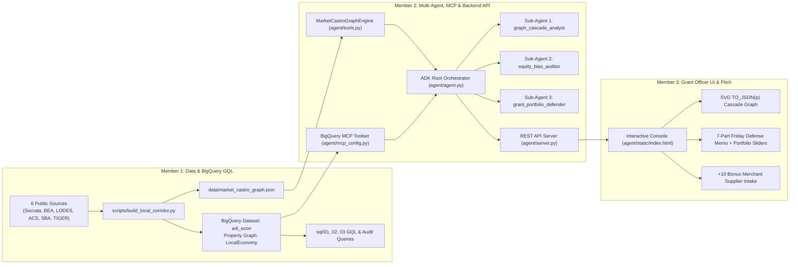

# 3-Member, 4-Hour Parallel Execution Plan — Agents for Impact 2026 (Challenge 03)

**Corridor:** `Market/Castro` (San Francisco, CA) — Parameterized for Any Commercial Corridor  
**Goal:** Ship a 100/100 + 10 Bonus winning submission in **4 Hours** with **zero merge conflicts**.

---

## 1. Team Role Division & File Ownership (Zero Git Conflicts)

| Team Member | Role Title | Primary Responsibility | Exclusive File Ownership |
| :--- | :--- | :--- | :--- |
| **Member 1** | **Data & BigQuery Property Graph Lead** | Load the 6 public datasets (`Socrata`, `BEA Make-Use`, `LODES 8`, `ACS 5-Yr`, `SBA 7(a)`, `TIGER`), build the local & BigQuery Property Graph (`a4i_econ.LocalEconomy`), validate all 7 GQL syntax rules, and run the equity/mailbox/monopoly SQL audits. | [`scripts/build_local_corridor.py`](file:///Users/subbavanipenta/Desktop/GCP%20Agents/scripts/build_local_corridor.py)<br>[`data/market_castro_graph.json`](file:///Users/subbavanipenta/Desktop/GCP%20Agents/data/market_castro_graph.json)<br>[`sql/01_create_property_graph.sql`](file:///Users/subbavanipenta/Desktop/GCP%20Agents/sql/01_create_property_graph.sql)<br>[`sql/02_gql_cascade_queries.sql`](file:///Users/subbavanipenta/Desktop/GCP%20Agents/sql/02_gql_cascade_queries.sql)<br>[`sql/03_equity_and_bias_audit.sql`](file:///Users/subbavanipenta/Desktop/GCP%20Agents/sql/03_equity_and_bias_audit.sql) |
| **Member 2** | **Workflow, Backend API, MCP & Multi-Agent Lead** | Build and verify the Google ADK Multi-Agent Orchestrator (`root_agent` + 3 specialist sub-agents), BigQuery MCP Toolset (`tools.yaml` + `mcp_config.py`), the 7 deterministic graph/portfolio tools (`tools.py`), and the REST API server (`server.py` + Cloud Run `Dockerfile`). | [`agent/schemas.py`](file:///Users/subbavanipenta/Desktop/GCP%20Agents/agent/schemas.py)<br>[`agent/prompts.py`](file:///Users/subbavanipenta/Desktop/GCP%20Agents/agent/prompts.py)<br>[`agent/tools.py`](file:///Users/subbavanipenta/Desktop/GCP%20Agents/agent/tools.py)<br>[`agent/mcp_config.py`](file:///Users/subbavanipenta/Desktop/GCP%20Agents/agent/mcp_config.py)<br>[`agent/tools.yaml`](file:///Users/subbavanipenta/Desktop/GCP%20Agents/agent/tools.yaml)<br>[`agent/agent.py`](file:///Users/subbavanipenta/Desktop/GCP%20Agents/agent/agent.py)<br>[`agent/server.py`](file:///Users/subbavanipenta/Desktop/GCP%20Agents/agent/server.py)<br>[`agent/Dockerfile`](file:///Users/subbavanipenta/Desktop/GCP%20Agents/agent/Dockerfile) |
| **Member 3** | **Frontend UI, Interactive Graph & Pitch Lead** | Build and polish the **Grant Officer Defense Console UI** (`index.html`), interactive SVG `TO_JSON(p)` network visualizer, $\Delta P$ survival & portfolio sliders, Track 3 anchor shock simulator, live Merchant Supplier Intake form (`+10 Bonus`), and lead the 6-slide deck + 3-minute demo video recording. | [`agent/static/index.html`](file:///Users/subbavanipenta/Desktop/GCP%20Agents/agent/static/index.html)<br>[`docs/PITCH_DECK_AND_VIDEO_SCRIPT.md`](file:///Users/subbavanipenta/Desktop/GCP%20Agents/docs/PITCH_DECK_AND_VIDEO_SCRIPT.md)<br>[`README.md`](file:///Users/subbavanipenta/Desktop/GCP%20Agents/README.md) |

---

## 2. Architecture & Integration Contract Between the 3 Members



---

## 3. Hour-by-Hour Execution Schedule (4 Hours Total)

### Hour 1 (`0:00 – 1:00`): Foundation, Data Pipeline & API Contract Lock
* **Member 1 (Data & BigQuery Lead):**
  1. Run [`scripts/build_local_corridor.py`](file:///Users/subbavanipenta/Desktop/GCP%20Agents/scripts/build_local_corridor.py) to generate and verify [`data/market_castro_graph.json`](file:///Users/subbavanipenta/Desktop/GCP%20Agents/data/market_castro_graph.json) (`327` storefronts, `1,199` `Supplies` edges, `677` `DrawsFootfall` edges, `10` LODES `Employer` blocks, `8` ACS Tracts, `9` SBA loans).
  2. Provision GCP BigQuery dataset `a4i_econ` and load the 6 base tables (`businesses`, `employer_blocks`, `supplies`, `draws_footfall_from`, `borrowed_from`, `tract_demographics`) via the notebook or `bq load`.
  3. Execute [`sql/01_create_property_graph.sql`](file:///Users/subbavanipenta/Desktop/GCP%20Agents/sql/01_create_property_graph.sql) to create `a4i_econ.LocalEconomy`.
* **Member 2 (Backend, MCP & Multi-Agent Lead):**
  1. Verify [`agent/schemas.py`](file:///Users/subbavanipenta/Desktop/GCP%20Agents/agent/schemas.py) and [`agent/tools.py`](file:///Users/subbavanipenta/Desktop/GCP%20Agents/agent/tools.py) load `data/market_castro_graph.json` cleanly in `<100ms`.
  2. Start the backend server (`python3 -m agent.server`) on `http://127.0.0.1:8080` so Member 3 immediately has live JSON endpoints to develop against.
  3. Configure [`agent/tools.yaml`](file:///Users/subbavanipenta/Desktop/GCP%20Agents/agent/tools.yaml) and [`agent/mcp_config.py`](file:///Users/subbavanipenta/Desktop/GCP%20Agents/agent/mcp_config.py) with the team's `GCP_PROJECT_ID`.
* **Member 3 (Frontend UI & Pitch Lead):**
  1. Connect [`agent/static/index.html`](file:///Users/subbavanipenta/Desktop/GCP%20Agents/agent/static/index.html) to `GET /api/overview` and `GET /api/memo`.
  2. Verify the top KPI header cards (`327` Storefronts, `1,199` BEA Supply Edges, `161` Disqualified Virtual Mailboxes, `$50,000` Grant Pool) render from live API data.
* **Checkpoint 1 (`T+60m`):** `python3 -m agent.server` is live and serving real `Market/Castro` graph data to the browser.

---

### Hour 2 (`1:00 – 2:00`): GQL Cascade Queries, Multi-Agent Orchestration & Interactive SVG Graph
* **Member 1 (Data & BigQuery Lead):**
  1. Execute all 4 queries in [`sql/02_gql_cascade_queries.sql`](file:///Users/subbavanipenta/Desktop/GCP%20Agents/sql/02_gql_cascade_queries.sql):
     - Query 1: Keystone Band Discovery (`5 to 28` downstream nodes using `NEXT` + `FILTER WHERE`).
     - Query 2: `ANY SHORTEST` + `TO_JSON(p)` path extraction for `Theatre Rhinoceros` (`1328524-03-231`), `Canela` (`0458630-01-001`), and `Cafe Du Nord` (`1140504-03-171`).
     - Query 3: Compounded (`i1 * i2`) vs. Bottleneck (`LEAST(i1, i2)`) cascade scoring.
     - Query 4: Track 3 two-direction anchor closure (`DrawsFootfall` + `Supplies`) for Block `060750171011001` (`400 Castro / Market Muni`).
  2. Save screenshots/exports of BigQuery GQL execution results for the pitch deck.
* **Member 2 (Backend, MCP & Multi-Agent Lead):**
  1. Wire and test the **Google ADK Multi-Agent Hierarchy** in [`agent/agent.py`](file:///Users/subbavanipenta/Desktop/GCP%20Agents/agent/agent.py):
     - `root_agent` (`market_castro_grant_advisor`) orchestrating:
       - `graph_cascade_analyst` (`discover_cascade_candidates`, `simulate_anchor_closure`, BigQuery MCP)
       - `equity_bias_auditor` (`audit_corridor_equity_and_bias`, `add_verified_merchant_supplier`)
       - `grant_portfolio_defender` (`generate_friday_grant_memo`, `compare_grant_candidates`, `optimize_corridor_portfolio`)
  2. Test all 7 REST API routes (`/api/overview`, `/api/candidates`, `/api/memo`, `/api/portfolio`, `/api/compare`, `/api/anchor-shock`, `/api/equity-audit`) and POST routes (`/api/merchant-intake`, `/api/chat`).
* **Member 3 (Frontend UI & Pitch Lead):**
  1. Build and test the **Interactive SVG `TO_JSON(p)` Cascade Graph Canvas** in [`agent/static/index.html`](file:///Users/subbavanipenta/Desktop/GCP%20Agents/agent/static/index.html):
     - Center node (Recommended Grantee), Inner ring (Hop-1 direct buyers), Outer ring (Hop-2 indirect buyers).
     - Color-code **Physical Storefronts** (emerald), **Virtual Mailbox Filings** (red dashed warning), and **Merchant-Verified Edges** (gold badge).
  2. Wire the **Keystone Band Candidate Table** so clicking any candidate immediately updates the SVG graph and the 7-Part Friday Defense Memo.
* **Checkpoint 2 (`T+120m`):** Clicking `Theatre Rhinoceros`, `Canela`, or `Cafe Du Nord` in the UI dynamically redraws `TO_JSON(p)` paths and updates the 7-part defense memo.

---

### Hour 3 (`2:00 – 3:00`): Bias Audit, Portfolio Optimizer, Track 3 Shock & +10 Bonus Loop
* **Member 1 (Data & BigQuery Lead):**
  1. Execute all 5 queries in [`sql/03_equity_and_bias_audit.sql`](file:///Users/subbavanipenta/Desktop/GCP%20Agents/sql/03_equity_and_bias_audit.sql):
     - Mechanical BEA bias audit (`Primo` `NAICS 3121` single-supplier monopoly proof).
     - Virtual mailbox hub audit (`140` filings at `2261 Market St` and `21` at `584 Castro St` using bare 4-digit PMBs).
     - Duplicate DBA audit (`The Castro` `429/449 Castro St`, `Mudpuppy's`, `Midnight Sun`, `The Edge`, `Beck's Motor Lodge`).
     - `LPAD(geo_id, 11, '0')` ACS Census Tract join (`06075016602` at `16.06%` poverty vs. `06075016900` at `3.79%`).
     - SBA 7(a) historical charge-off ground truth (`Castro Tarts` & `Jake's Castro Kitchen`).
  2. Verify multi-corridor parameterization by testing `CORRIDOR_NAME` override in [`scripts/build_local_corridor.py`](file:///Users/subbavanipenta/Desktop/GCP%20Agents/scripts/build_local_corridor.py).
* **Member 2 (Backend, MCP & Multi-Agent Lead):**
  1. Verify `optimize_corridor_portfolio` (`/api/portfolio`) proving why **2 businesses (`Theatre Rhinoceros` + `Canela`)** have `0%` overlap (`13` unique physical storefronts protected), while `#3 The Castro` is `91.7%` redundant and `#4 Hi Tops` is `100%` redundant.
  2. Verify the **+10 Bonus Live Merchant Supplier Intake** (`POST /api/merchant-intake` -> `add_verified_merchant_supplier`), confirming it upgrades modeled BEA edges to `MERCHANT_VERIFIED`, recalculates cascade scores live, and outputs the BigQuery `MERGE INTO a4i_econ.supplies` DML statement.
* **Member 3 (Frontend UI & Pitch Lead):**
  1. Wire the **Survival Probability ($\Delta P$) & Grant Allocation Sliders** (`Grant Amount`, `Budget Pool`, `P(Fail | No Grant)`, `P(Fail | With Grant)`, `Substitutability Discount`).
  2. Wire the **Track 3 Anchor Closure Simulator** dropdown (`Block 060750171011001` `400 Castro / Market Muni`, `Block 060750171011003` `18th & Castro`, `Block 060750202011002` `2100 Market / Church`).
  3. Wire the **+10 Bonus Merchant Supplier Verification Form** and the **Grant Officer Chat Drawer**.
* **Checkpoint 3 (`T+180m`):** Full end-to-end walkthrough of all UI tabs, sliders, Track 3 shock simulation, and live merchant edge verification passes with zero errors.

---

### Hour 4 (`3:00 – 4:00`): Cloud Run Deployment, Pitch Deck Polish & 3-Minute Video Recording
* **Member 1 (Data & BigQuery Lead):**
  1. Double-check all numbers in the pitch slides against BigQuery & [`data/market_castro_graph.json`](file:///Users/subbavanipenta/Desktop/GCP%20Agents/data/market_castro_graph.json) (`1,566 -> 327` storefronts, `1,199` edges, `140` virtual mailboxes at `2261 Market St`, `Theatre Rhinoceros` `KeystoneScore = 0.3461`, `Canela` `KeystoneScore = 0.2927`).
  2. Co-present the **Data Hygiene & GQL Graph Architecture** segment (`0:35 – 1:25`) in the 3-minute video.
* **Member 2 (Backend, MCP & Multi-Agent Lead):**
  1. Run final automated verification suite across all tools and endpoints.
  2. Optional Cloud Run deployment via [`agent/Dockerfile`](file:///Users/subbavanipenta/Desktop/GCP%20Agents/agent/Dockerfile) (`gcloud run deploy market-castro-grant-console --source . --region us-central1 --allow-unauthenticated`) or `adk web`.
  3. Co-present the **Multi-Agent ADK + Subgraph Portfolio Optimization & +10 Bonus Loop** segment (`1:25 – 2:20`) in the 3-minute video.
* **Member 3 (Frontend UI & Pitch Lead):**
  1. Finalize the 6-slide pitch deck from [`docs/PITCH_DECK_AND_VIDEO_SCRIPT.md`](file:///Users/subbavanipenta/Desktop/GCP%20Agents/docs/PITCH_DECK_AND_VIDEO_SCRIPT.md).
  2. Record the crisp **3-Minute Screen-Share Video Demo** showing the live Grant Officer Defense Console, the `TO_JSON(p)` graph, the `Theatre Rhinoceros` vs. `Cafe Du Nord` virtual-mailbox reveal, the `2-Business` non-overlapping portfolio proof, and the live `+10 Bonus` merchant invoice intake.
* **Final Submission (`T+240m`):** Submit GitHub repo URL, 3-minute video link, and 6-slide PDF deck.

---

## 4. Quick-Start Verification Commands for Each Member

### Member 1 (Data & Graph Verification)
```bash
python3 scripts/build_local_corridor.py
ls -lh data/market_castro_graph.json
```

### Member 2 (Multi-Agent & Backend API Verification)
```bash
python3 -c "
from agent.agent import root_agent, run_grant_officer_chat
from agent.server import handle_api_get, handle_api_post
print('Overview API:', handle_api_get('/api/overview', '')[0])
print('Portfolio API:', handle_api_get('/api/portfolio', 'budget_pool=50000&num_grantees=2')[0])
print('Chat Router:', run_grant_officer_chat('Why Theatre Rhinoceros vs Cafe Du Nord?')['tool_called'])
"
```

### Member 3 (UI & Live Console Launch)
```bash
python3 -m agent.server
# Open http://127.0.0.1:8080 in browser
```
